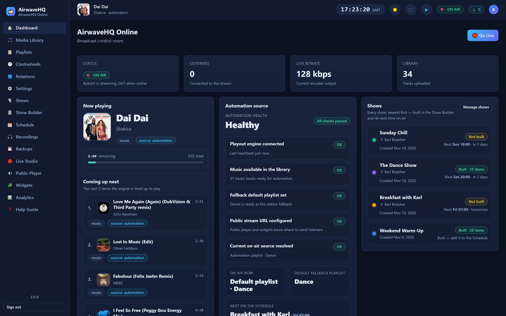
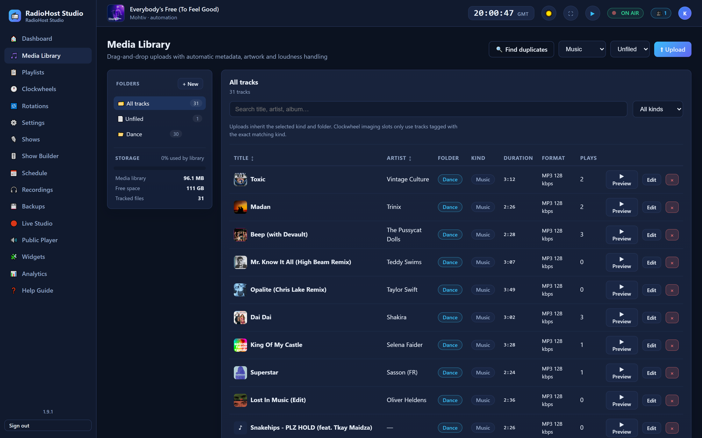
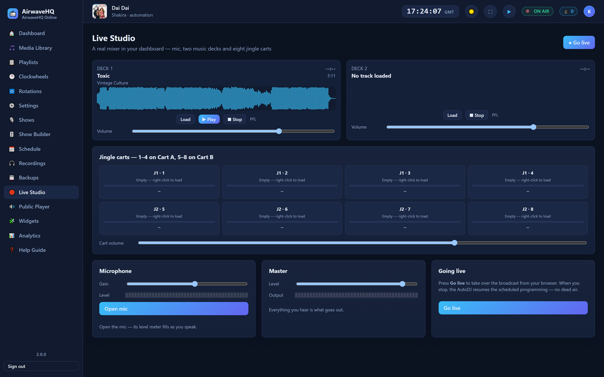
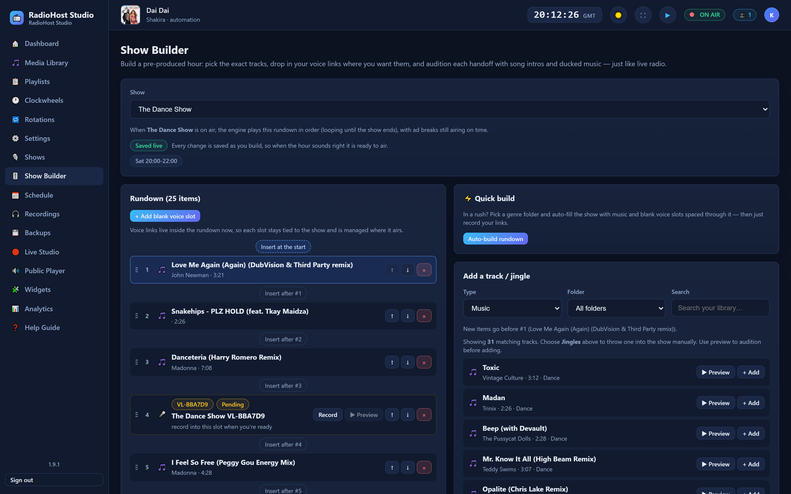
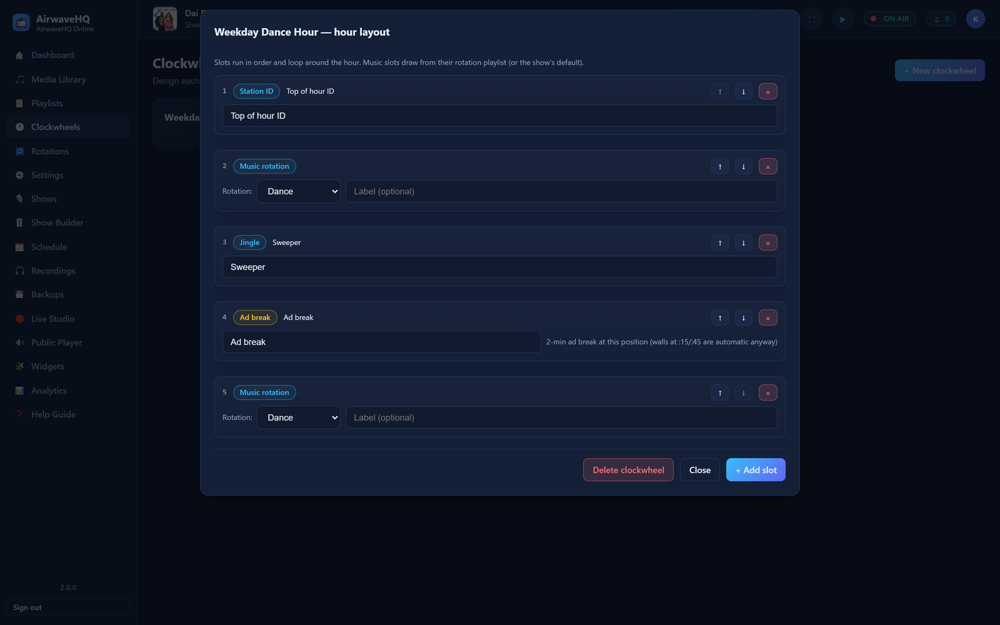
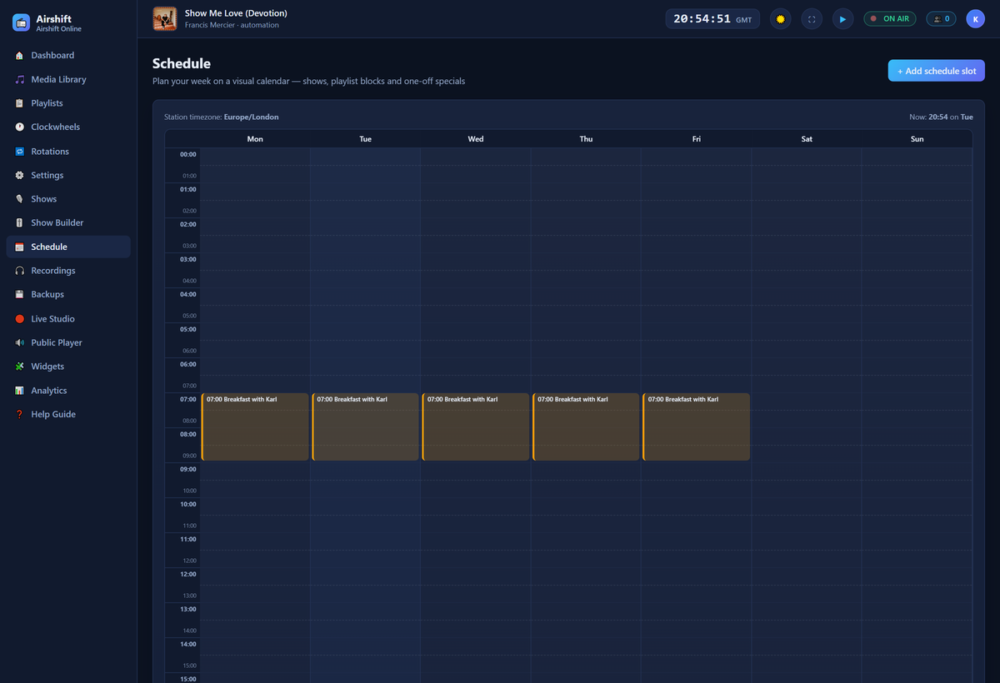
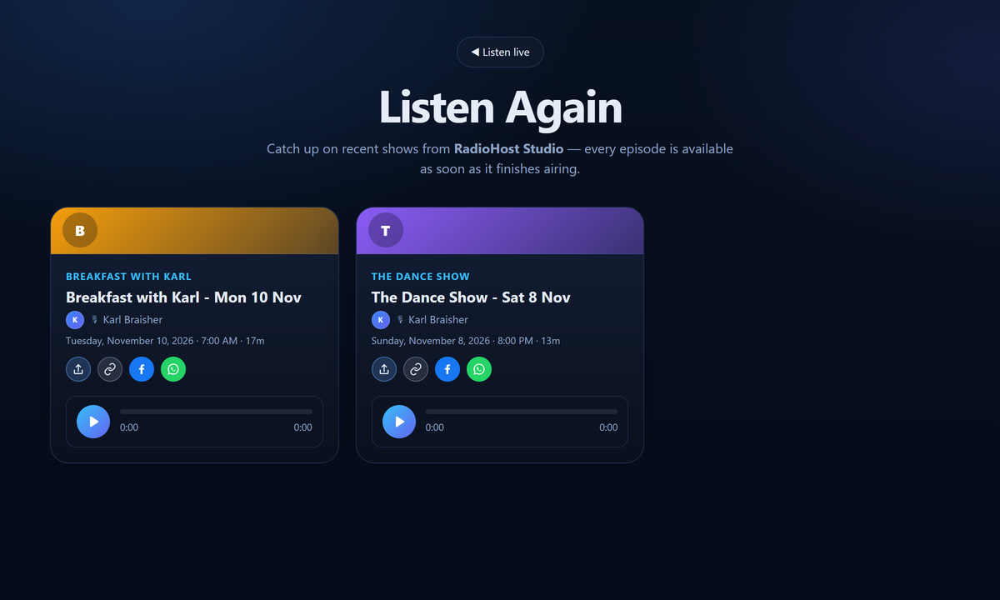
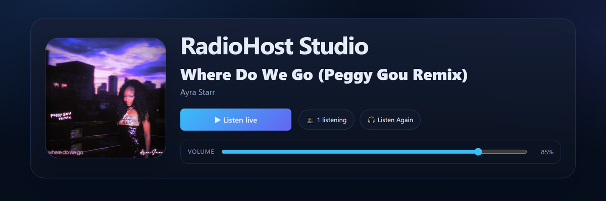
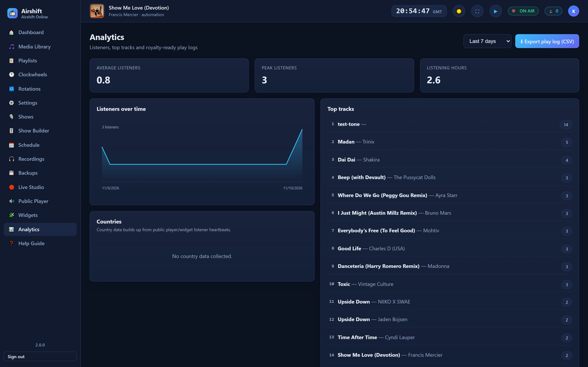
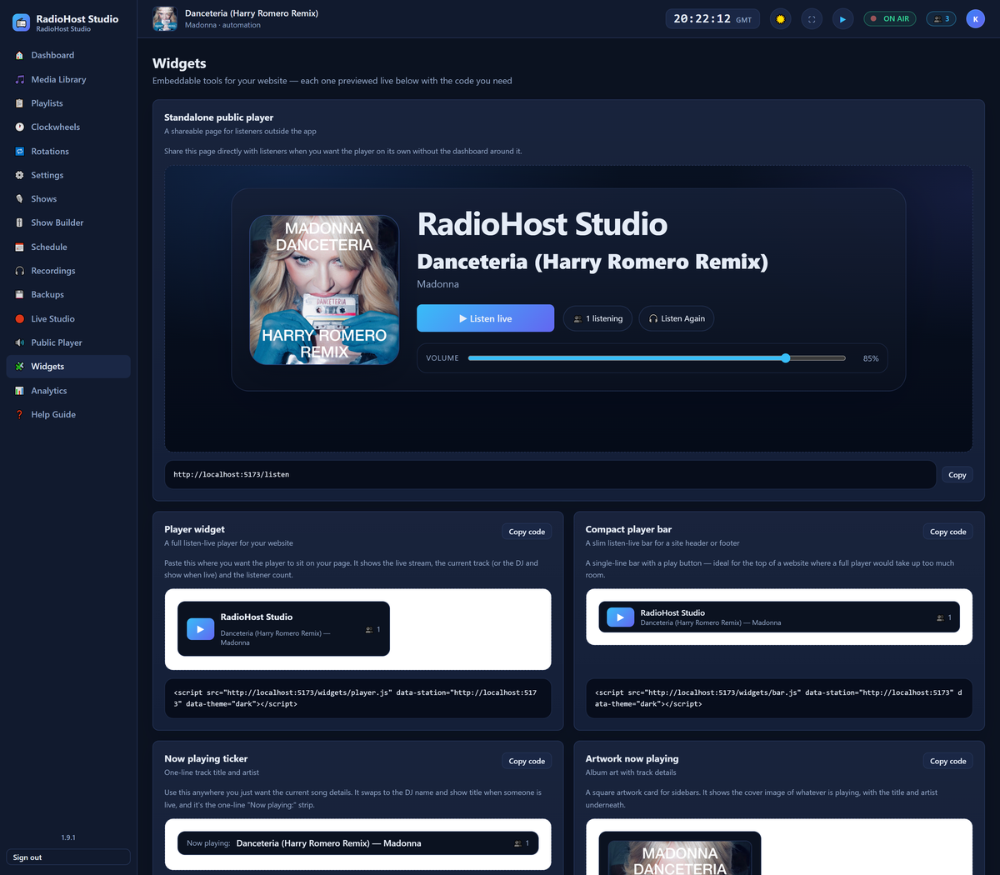

# Airshift


A complete, self-hosted internet radio station that runs on your own Linux VPS —
no SaaS fees, no per-listener pricing. Your music, your listeners, your data,
all yours.

It combines an always-on automated playout engine, a browser-based Live Studio
for DJs, a weekly schedule that runs the whole station, and polished public
pages for your listeners — everything installed with one script.

## Screenshots



| Media Library | Live Studio |
| --- | --- |
|  |  |

| Show Builder | Clockwheels |
| --- | --- |
|  |  |

| Weekly schedule | Listen Again |
| --- | --- |
|  |  |

| Public player | Analytics |
| --- | --- |
|  |  |

### Embeddable widgets

Every widget is previewed live next to the one-line snippet you paste into your
own site.



## What it does

**Automated playout engine**
- 24/7 automation that never stops: music, jingles, sweepers, station IDs and
  ad breaks all fire exactly to the clock
- Hour-to-hour discipline — tracks crossing the top of the hour fade out and an
  optional top-of-hour jingle plays at exactly `:00`
- Ad breaks anchored at `:15` / `:45` past the hour
- Station-wide audio processing presets (**Gentle / Radio / Punch**) for a
  professional broadcast sound
- Gapless crossfades and per-track loudness normalisation on upload

**Live Studio (in the browser)**
- Two decks with waveforms, crossfader, per-deck EQ and mic ducking
- Jingle carts and a microphone channel with master level control
- DJs can only go live inside their admin-allocated recurring slots
  (server-enforced); go-live custom show name shown on the public player
- Real DJ takeover — automation ducks out, then resumes seamlessly on disconnect

**Programming & schedule**
- Media library with cover art, format/bitrate display, jingles & sweepers
- Playlists, clockwheels (timed position-based rotation), rotation rules
- **Shuffle each pass** — a long playlist (a 24-hour default, for example) can
  restart in a brand-new running order every time it loops, so the same tunes
  never play in the same sequence twice. Jingles and sweepers stay exactly where
  you placed them; the Auto build dialog offers it for new playlists
- Weekly schedule (Monday-first) to plan **Shows, Playlist blocks, Rotation
  blocks and Clockwheel blocks** from one popup
- Show Builder with in-browser voice-link recording and one-click **Quick build**
  (1 / 2 / 3 hr auto-fill from a genre folder)
- Admin-allocated DJ show slots; DJs can only create/edit **their own** shows
- Recordings manager: browse, play, rename, publish/hide and delete automatic
  show recordings

**Listeners & public facing**
- Polished public player, Listen Again page, podcast RSS feed
- Embeddable widgets (player, now-playing ticker, request box)
- Geo-restrictions to block or allow listeners by country

**Monetization & analytics**
- Ad campaigns with flight dates, capping and placement rules, plus a planner
  and airing reports
- Listener analytics: concurrent listeners, top tracks, countries, CSV export

**Operations**
- Light & dark themes, top-bar live-stream play button, full-screen "desktop app" mode
- One-click **Backup & Restore** (database, data, config) with upload
- Webhooks and API keys

## Install on a fresh Linux VPS (one script)

**Requirements:** Ubuntu 22.04+ or Debian 12+, a domain whose **A record** points
at the server, and ports **80** and **443** open. Docker is installed for you if
it isn't there already.

1. Get the code onto the server:

   ```bash
   git clone https://github.com/kfbhost/airshift.git
   cd airshift
   ```

   (No git on the box? `rsync` the folder over instead — see
   `docs/VPS_SETUP.md`.)

2. Run the installer:

   ```bash
   sudo bash infra/install-vps.sh
   ```

The installer asks for your domain and admin email, generates every secret,
builds and starts the whole station, waits until the API is healthy, and prints
your login details. That's all there is to it.

Unattended / scripting:

```bash
sudo bash infra/install-vps.sh \
  --domain radio.example.com \
  --email boss@example.com \
  --password "a-strong-password" \
  --station "My Radio Station" \
  --timezone Europe/London \
  --yes
```

Re-running the script later just rebuilds and restarts the stack, keeping your
settings.

### After install

1. Log in with the admin email/password shown at the end.
2. **Library** → upload your music (mp3/flac/wav/ogg/m4a).
3. **Playlists** → create a song playlist and add tracks.
4. **Settings** → set your default playlist so AutoDJ can play.
5. The station is broadcasting on the air.

The dashboard lives at `/` and the **Live Studio** at `/studio`. Listeners get
the Icecast stream at `/live`, which is why the studio has its own route.

## Local development

Requires Node 20+, `ffmpeg`/`ffprobe` on your `PATH`, and PostgreSQL.

```bash
npm install
npm run db:push     # create the database schema
npm run dev:api     # API on :8080
npm run dev:engine  # playout engine on :9002 (separate terminal)
npm run dev:web     # dashboard on :5173
```

Open http://localhost:5173 — on a fresh database the first-run screen creates
your admin account. Configuration is read from `process.env` (nothing is loaded
from `.env` automatically); `.env.example` lists every variable, and the Docker
path supplies them through Compose.

Checks:

```bash
npm run typecheck   # all packages
npm test            # unit tests (vitest)
npm run build       # production builds for api, engine, web and widgets
```

### Backups & moving to a new server

Use **Settings → Backups** in the dashboard to create a backup (database, data
and config), download all three files, then **Restore** on the new install. The
code is identical everywhere — only your music and data need moving.

## Where things live

```
infra/
  install-vps.sh       ← run this to install on a fresh VPS
  docker-compose.yml   Full production stack (postgres, icecast, api, engine, web, caddy)
  Caddyfile            Automatic HTTPS + routing
  backup.sh            DB + media backup script
  pack-release.sh      Re-pack this release folder / bundle
apps/
  api/      Fastify REST API, scheduler, auth, analytics
  engine/   Playout engine (playout, Icecast sink, live-DJ WebSocket)
  web/      React dashboard, Live Studio, public player & Listen Again
  widgets/  Embeddable player / now-playing / request widget bundles
packages/
  shared/   Shared types, validation, time utilities
```

## Docs

- `START-HERE.md` — quick start summary
- `docs/VPS_SETUP.md` — full install guide, flags, updates, backups, troubleshooting

## License

MIT — see [LICENSE](LICENSE).